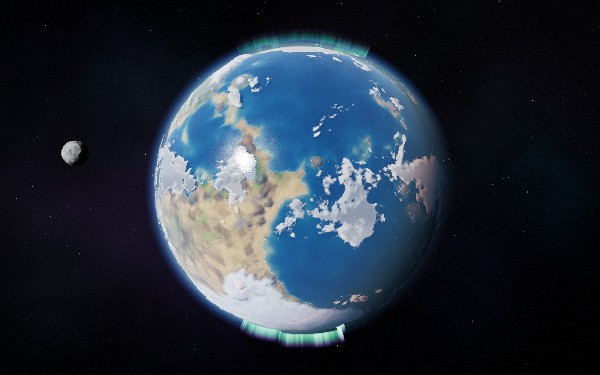
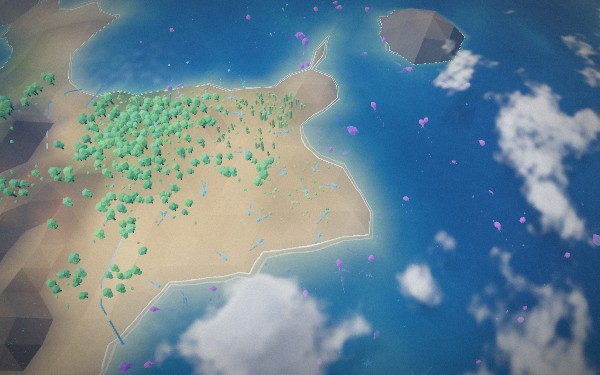
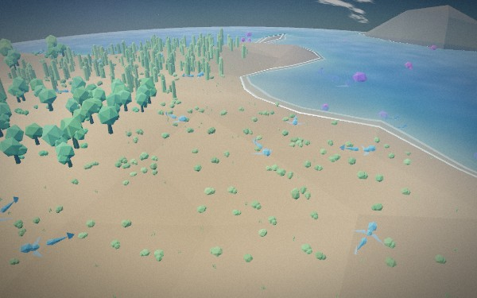
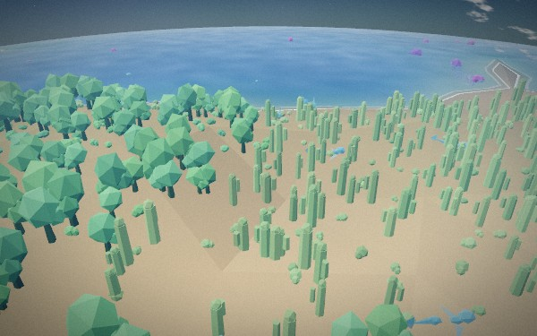
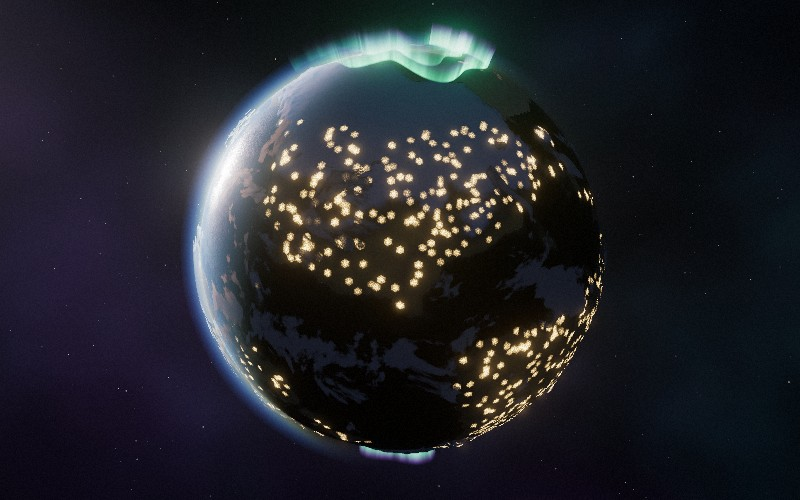

# Genesis

**Live site:** https://electriccookie23.github.io/Genesis-World/ (works once GitHub Pages is switched on for this repo; see DECISIONS.md #2)

Genesis is a 3D web experience of a small planet where geology, climate, life and eventually civilization evolve on their own in real time. It is a living simulation you watch and poke at, not a game with goals.

Nothing is scripted. Every species, extinction and forest emerges from the simulation, and every event records what caused it, so you can click anything in the chronicle and trace its story back to the root.

## Screenshots

Seed `amber-reef-101` after 120 million years (captured with software rendering at low resolution; a real GPU looks sharper).

| From orbit | A wooded coast |
|---|---|
|  |  |
| **Near the ground** | **Woodland** |
|  |  |

The night side, with an aurora over the pole and city lights (this frame uses test lights to show the rendering; in a run they come from real settlements):



## Run it locally

```bash
npm install
```

```bash
npm run dev
```

Then open the address Vite prints. Other commands:

- `npm test` runs the headless simulation tests (about five minutes: five whole histories)
- `npm run typecheck` checks the TypeScript
- `npm run build` builds the static site into `dist/`

Useful URL options: `?seed=amber-reef-101` picks the world, `&skip` skips the opening, `&webgl` forces WebGL2.

## Controls

| Input | Action |
|---|---|
| Drag | Orbit the planet |
| Scroll or pinch | Zoom, in one range from deep space to the ground |
| Right-drag or two-finger drag | Turn and tilt near the surface |
| Click a creature | Select it (you hear its call). Double-click or F follows it |
| V | First-person view from the followed creature |
| U | Allow the camera to dive under the sea |
| Space | Pause or play |
| 1 to 6 | Speed: pause, 1x, 10x, 100x, 1000x, Epoch |
| C | Chronicle |
| T | Tree of life |
| G | God tools |
| M | Flat map (click it to fly there) |
| X | Cross-section of the ground under the view |
| O | Overlays: temperature, rain, life, people, fossils |
| P | Postcard mode |
| H | Hide or show the interface |
| Esc | Close panels, stop following |
| ? | Controls list |

## A short tour

- **The opening.** A dust disc collapses into a molten planet, the moon is struck off, the crust cools, rain falls and the seas fill. The planet that forms is the real seeded one.
- **Epoch speed (key 6).** A whole history, about 500 million years, in roughly half an hour. Life starts in the sea, oxygen builds, plants take the land, animals follow. Continents drift, ice ages come and go.
- **The chronicle (C).** A calm documentary voice narrates what happens. Click any line to open "Why did this happen?" and walk the chain of causes backward.
- **The tree of life (T) and field guide.** Every named species as a glowing branch, a card for each living one, and a memorial for those that are gone.
- **Down on the ground.** Trees, shrubs, grass and mushrooms grow from the genes of the local plants; creatures are built from their genomes. Hunters chase, herds bolt, night animals sleep by day, the young of some species look nothing like their parents.
- **Peoples.** In some worlds a lineage grows clever. Then come fire, cave paintings of real animals, villages, farms, tamed herds, faiths founded on real eclipses and eruptions, cities whose lights show from orbit, wars, ships, and sometimes a space age and a departure. In other worlds nobody ever lights a fire.
- **God tools (G).** Meteor, lightning, plague, raise mountains, flood, ice age, heat wave, gene ray, shield dome, monolith, summon a comet, tilt the axis, rain of life, shatter the moon into a ring, or design a species and set it down. Use them often enough and the villagers build temples that face the sky. Hands-off mode locks them all.
- **Keepsakes.** Photo filters and PNG export, video recording, a printable illustrated history of your planet, ten save slots, rewind points at every great event, and a seed link that replays the same world.

## How it works

- `src/sim` is the simulation. It runs in a Web Worker and never imports Three.js. The planet is an icosphere of 39,692 cells holding elevation, temperature, moisture, biome, vegetation and more. Life is simulated as populations with real genomes on a coarser grid of regions: they eat, are eaten, starve, freeze, breed, wander and mutate. There is no fitness score; selection is whatever happens to them.
- `src/render` draws it with Three.js (WebGPU with automatic WebGL2 fallback), shaders written in TSL: faceted terrain, a depth-coloured ocean with sun glint and foam, ray-marched atmospheric scattering, a drifting cloud shell that casts shadows, a procedural starfield and moon, instanced plants and creatures, bloom and ACES tone mapping.
- `src/ui` is a light Preact overlay.
- `tests` runs whole histories headless in Node and checks stability, determinism and that every extinction and new species records a cause.

## Project documents

- BRIEF.md: the full build brief
- PROGRESS.md: status of all 150 features
- DECISIONS.md: choices made along the way
- HANDOFF.md: where the work stands, for resuming
- CREDITS.md: assets and licenses
