# Genesis

**Live site:** https://electriccookie23.github.io/Genesis-World/ (works once GitHub Pages is switched on for this repo; see DECISIONS.md #2)

Genesis is a 3D web experience of a small planet where geology, climate, life and eventually civilization evolve on their own in real time. It is a living simulation you watch and poke at, not a game with goals.

Nothing is scripted. Every species, extinction and forest emerges from the simulation, and every event records what caused it, so you can click anything in the chronicle and trace its story back to the root.

## Before and after the graphics overhaul

The same world (seed `amber-reef-101`, about 150 million years in) from eight fixed views, before and after the renderer was rebuilt. Both sets were captured with software rendering at low resolution on the build machine, so they show what is drawn, not how sharp or fast it is on a real GPU.

| View | Before | After |
|---|---|---|
| From orbit, day side | 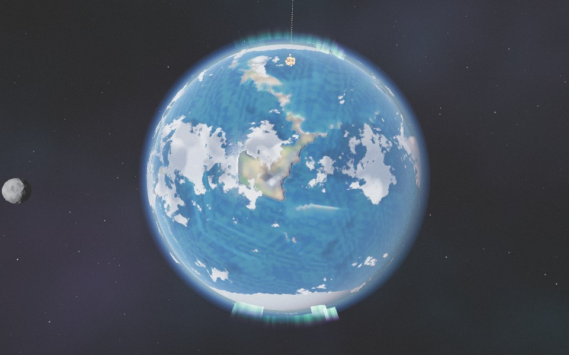 | 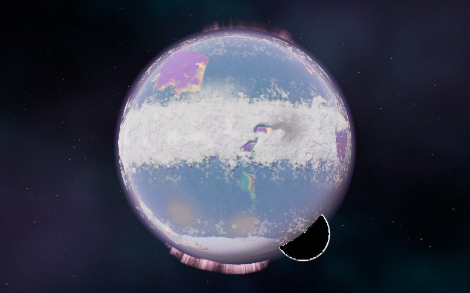 |
| From orbit, night side | 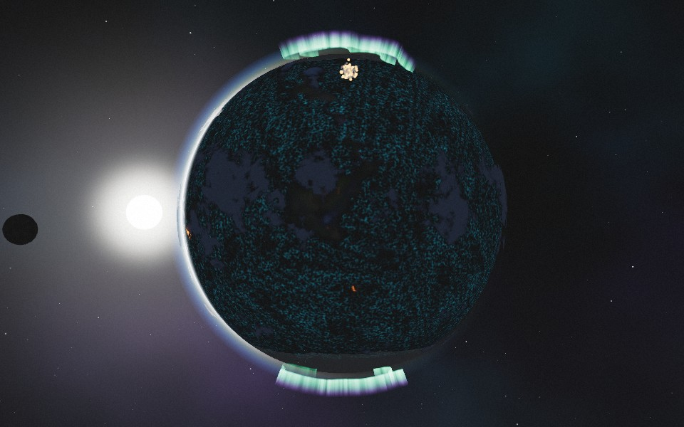 | 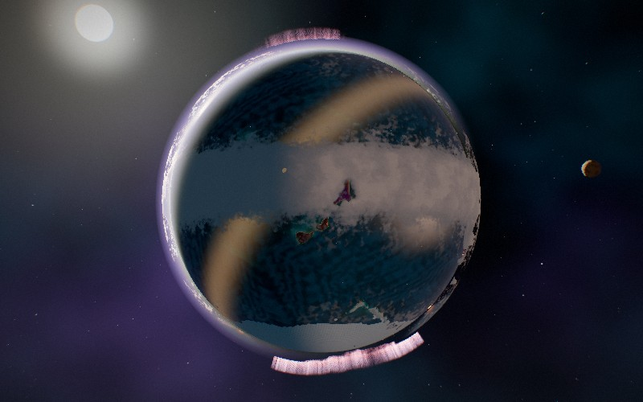 |
| The terminator | 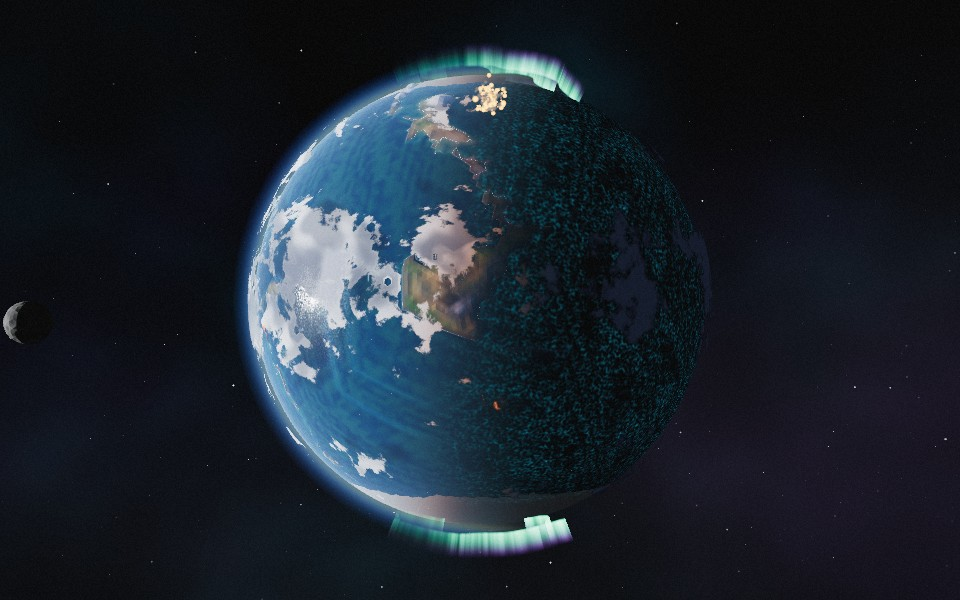 | 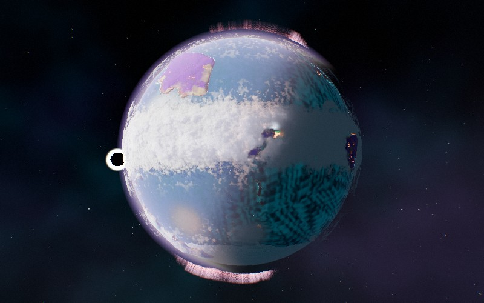 |
| Night map with a civilization | 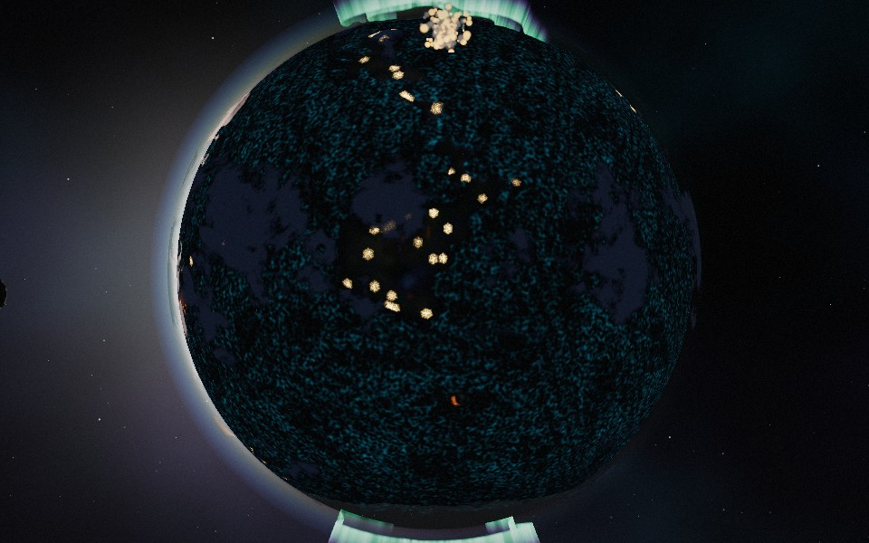 | 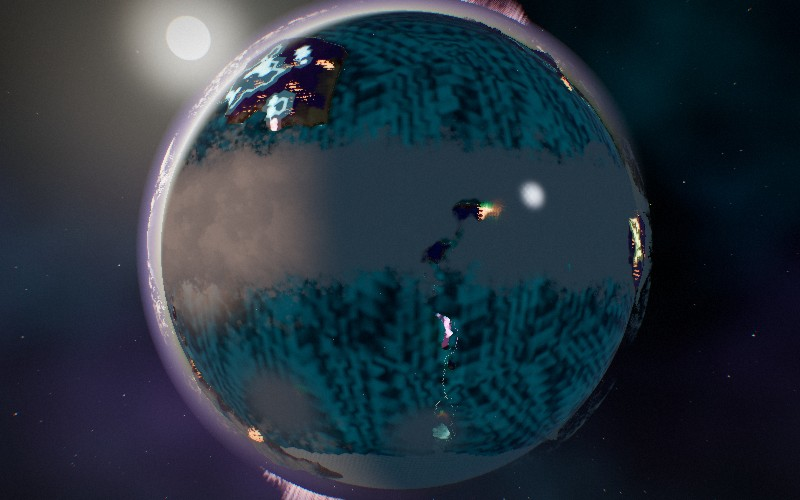 |
| Mid-altitude over a coast | 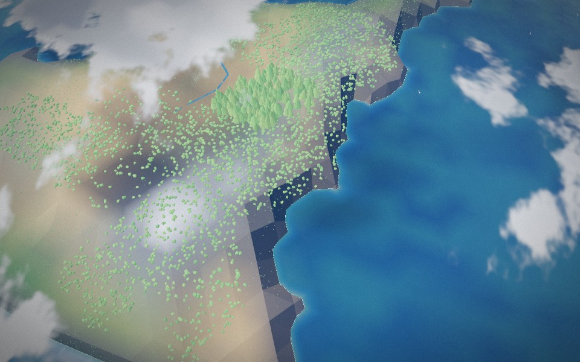 | 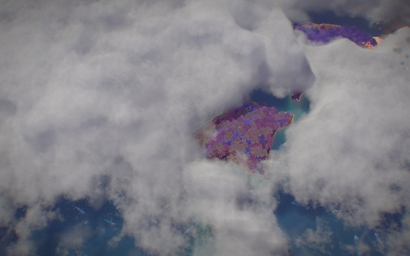 |
| Ground level in a forest | 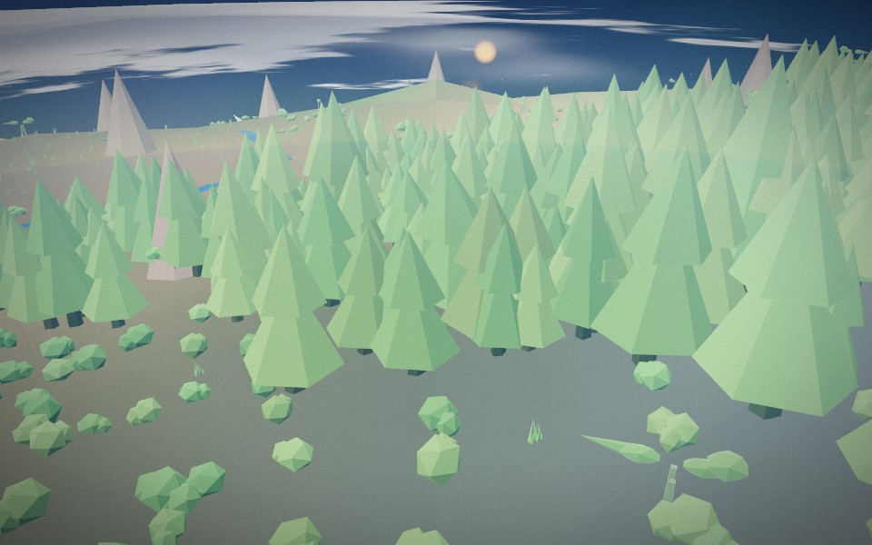 | 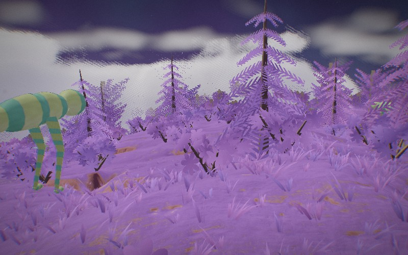 |
| Ground level at night | 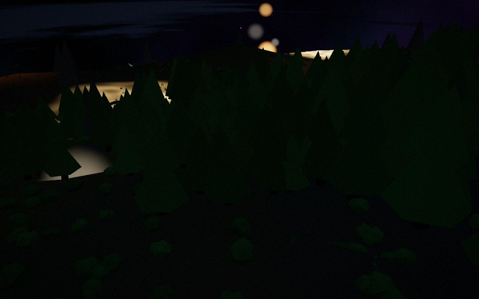 | 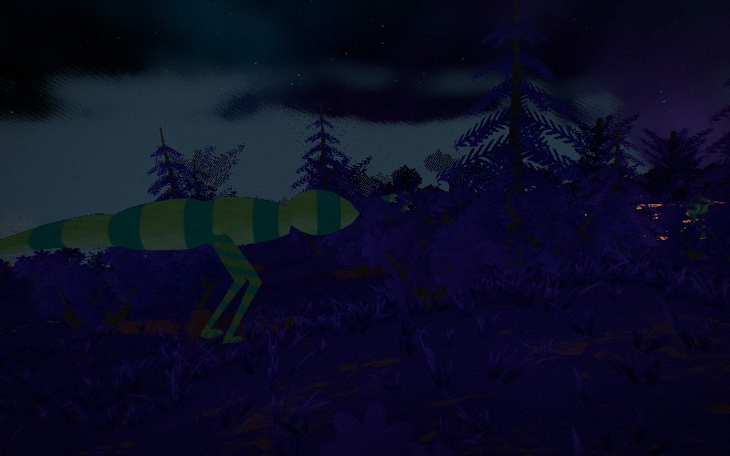 |
| Under water | 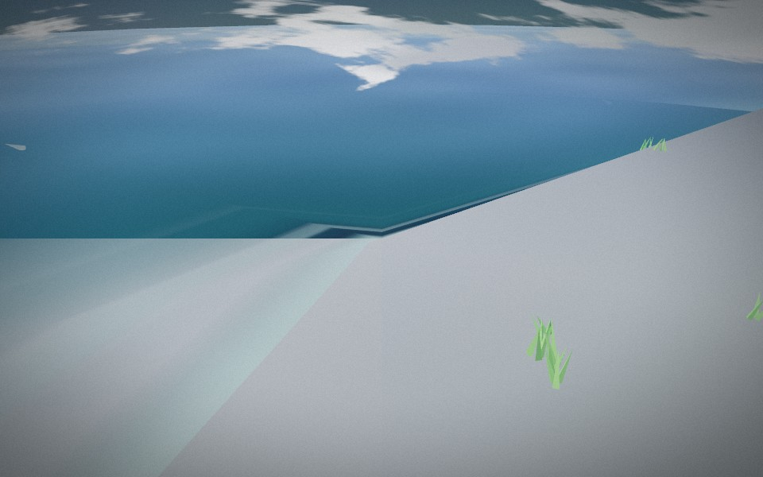 | 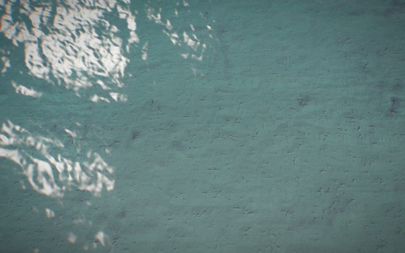 |

The night-map views use made-up settlements where the world had not yet produced any of its own at that age.

What changed, in short:

- **An alien world.** Each seed has its own star (yellow, orange or blue-white), sky colour, sea colour, rock, plant pigments, moon tint and aurora colours. Nothing uses Earth's defaults.
- **Smooth, detailed ground.** A quadtree cube-sphere that refines toward the camera, displaced by the simulation's terrain plus detail from a hydraulic erosion simulation run on the GPU, shaded per pixel (rock strata, sand, soil, salt crust, snow, fractured ice, plant cover, farmland, sea bed and coral). Rivers and roads are drawn into the ground itself. Mountains cast shadows.
- **A real sea.** FFT waves (checked against a CPU reference) driven by the simulation's wind, see-through water with true depth, foam, glitter, caustics, ice, and a view from below.
- **Volumetric clouds** with storm towers, cyclones with an eye, shadows, lightning, ash and smoke columns.
- **A readable night side.** Tinted moonlight, airglow, auto exposure, and nations shown as networks of light in their own colours, with borders, names and emblems on the Night Map.
- **Aurora as light,** in thin folding curtains around the magnetic poles.
- **Plants and animals as models,** not blocks: twelve plant forms with cut-out leaves, imposters at distance and grass underfoot; animals with a continuous skin, jointed legs solved by IK, fur, scales, feathers and eyes that follow you.
- **Post-processing:** temporal anti-aliasing, ambient occlusion, restrained bloom, AgX tone mapping.

## Run it locally

```bash
npm install
```

```bash
npm run dev
```

Then open the address Vite prints. Other commands:

- `npm test` runs the headless simulation tests (about five minutes: five whole histories)
- `npm run typecheck` checks the TypeScript
- `npm run build` builds the static site into `dist/`

Useful URL options: `?seed=amber-reef-101` picks the world, `&skip` skips the opening, `&webgl` forces WebGL2.

Quality presets (Settings): Low, Medium, High and Ultra. High is the default on desktop and is meant for a good laptop; Ultra may need a strong desktop GPU; Low is for phones. Texture sizes are fixed when the planet is built, so a preset change takes full effect after a reload.

## Controls

| Input | Action |
|---|---|
| Drag | Orbit the planet |
| Scroll or pinch | Zoom, in one range from deep space to the ground |
| Right-drag or two-finger drag | Turn and tilt near the surface |
| Click a creature | Select it (you hear its call). Double-click or F follows it |
| V | First-person view from the followed creature |
| U | Allow the camera to dive under the sea |
| Space | Pause or play |
| 1 to 6 | Speed: pause, 1x, 10x, 100x, 1000x, Epoch |
| C | Chronicle |
| T | Tree of life |
| G | God tools |
| M | Flat map (click it to fly there) |
| X | Cross-section of the ground under the view |
| O | Overlays: temperature, rain, life, people, fossils, nations (the Night Map) |
| P | Postcard mode |
| H | Hide or show the interface |
| Esc | Close panels, stop following |
| ? | Controls list |

## A short tour

- **The opening.** A dust disc collapses into a molten planet, the moon is struck off, the crust cools, rain falls and the seas fill. The planet that forms is the real seeded one.
- **Epoch speed (key 6).** A whole history, about 500 million years, in roughly half an hour. Life starts in the sea, oxygen builds, plants take the land, animals follow. Continents drift, ice ages come and go.
- **The chronicle (C).** A calm documentary voice narrates what happens. Click any line to open "Why did this happen?" and walk the chain of causes backward.
- **The tree of life (T) and field guide.** Every named species as a glowing branch, a card for each living one, and a memorial for those that are gone.
- **Down on the ground.** Trees, shrubs, grass and mushrooms grow from the genes of the local plants; creatures are built from their genomes. Hunters chase, herds bolt, night animals sleep by day, the young of some species look nothing like their parents.
- **The Night Map.** Press O until the overlay reads nations, or use the Peoples panel: borders, names and emblems of every nation, each lit in its own colour, with roads and sea lanes between its towns.
- **Peoples.** In some worlds a lineage grows clever. Then come fire, cave paintings of real animals, villages, farms, tamed herds, faiths founded on real eclipses and eruptions, cities whose lights show from orbit, wars, ships, and sometimes a space age and a departure. In other worlds nobody ever lights a fire.
- **God tools (G).** Meteor, lightning, plague, raise mountains, flood, ice age, heat wave, gene ray, shield dome, monolith, summon a comet, tilt the axis, rain of life, shatter the moon into a ring, or design a species and set it down. Use them often enough and the villagers build temples that face the sky. Hands-off mode locks them all.
- **Keepsakes.** Photo filters and PNG export, video recording, a printable illustrated history of your planet, ten save slots, rewind points at every great event, and a seed link that replays the same world.

## How it works

- `src/sim` is the simulation. It runs in a Web Worker and never imports Three.js. The planet is an icosphere of 39,692 cells holding elevation, temperature, moisture, biome, vegetation and more. Life is simulated as populations with real genomes on a coarser grid of regions: they eat, are eaten, starve, freeze, breed, wander and mutate. There is no fitness score; selection is whatever happens to them.
- `src/render` draws it with Three.js (WebGPU with automatic WebGL2 fallback; both look the same), shaders written in TSL. The simulation's per-cell state is baked into cube-map textures every update, and every layer reads the planet from those: the quadtree terrain, the FFT ocean, the ray-marched clouds, atmosphere and aurora, the night map. Plants, grass and animals are instanced models that find the ground in the vertex shader. `src/render/gfx` holds the new renderer; DECISIONS.md explains the choices.
- `src/ui` is a light Preact overlay.
- `tests` runs whole histories headless in Node and checks stability, determinism and that every extinction and new species records a cause.

## Project documents

- BRIEF.md: the full build brief
- PROGRESS.md: status of all 150 features
- DECISIONS.md: choices made along the way
- HANDOFF.md: where the work stands, for resuming
- CREDITS.md: assets and licenses
